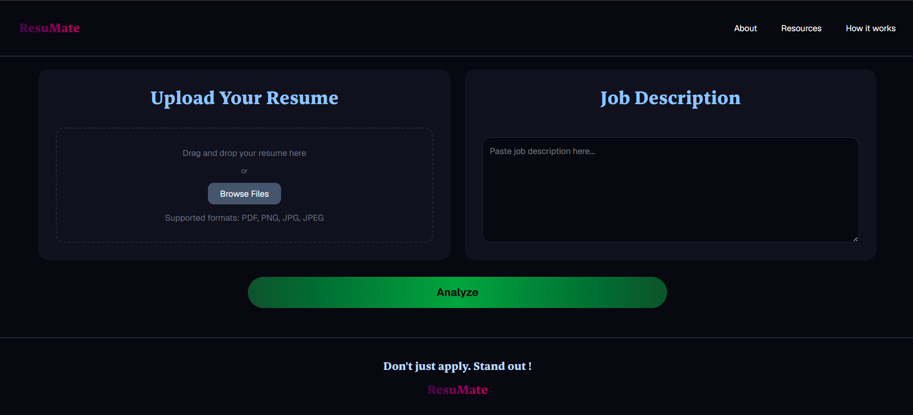

# ResuMate – AI-Powered Resume Analyzer

<p align="center">
  <b>Your Resume's Smartest Mate.</b>
</p>

<p align="center">
  An AI-powered resume analysis platform that helps candidates understand how well their resumes align with job descriptions, identify skill gaps, and improve their chances of standing out.
</p>

---
<p align="center">
  
</p>

## About the Project

**ResuMate** is an AI-powered resume analyzer designed to help job seekers optimize their resumes for specific job opportunities.

It analyzes an uploaded resume against a given job description using AI and custom ATS-style skill matching techniques.

Instead of providing just a match score, ResuMate delivers detailed insights into a candidate's strengths, missing skills, resume quality, project experience, and areas that need improvement.

## Features

### 1. Resume Parsing
- Upload resumes in PDF, PNG, and JPG/JPEG formats.
- Extract text from PDF documents and images.
- OCR-based text extraction for image resumes.

### 2. AI-Powered Resume Analysis
- Extract relevant skills from resumes.
- Identify job requirements and their importance.
- Analyze candidate strengths and weaknesses.
- Identify missing skills and qualifications.
- Evaluate overall resume quality.

### 3. ATS-Style Matching
- Calculate a weighted resume-to-job-description match score.
- Identify matched and missing skills.
- Compare candidate skills with job requirements.

### 4. Detailed Analysis & Recommendations
- Overall resume assessment.
- Strengths with supporting evidence.
- Missing skills and improvement areas.
- Bullet-point and content improvements.
- Formatting and design review.
- Job-specific suggestions.
- Prioritized improvement roadmap.
- Project evidence analysis.

### 5. Additional Pages
- **About:** Learn about ResuMate and its purpose.
- **How It Works:** Understand the resume analysis process.
- **Resources:** Explore resume-writing tips and improvement guides.

---

## Tech Stack

| Category | Technologies |
|---|---|
| Frontend | React.js, Vite, Tailwind CSS |
| UI Components | shadcn/ui |
| Backend | Node.js, Express.js |
| AI Service | Python, FastAPI |
| AI Integration | Groq API |
| Resume Parsing | PyMuPDF, PyTesseract, Pillow |
| HTTP Communication | Axios |
| Styling | Tailwind CSS |

---

## System Architecture

ResuMate follows a three-layer architecture:

```text
             USER
               |
               v
       React Frontend
          (Vite)
               |
               v
       Express Backend
          (Node.js)
               |
               v
        Python Service
           (FastAPI)
               |
          +----+----+
          |         |
          v         v
      Resume      Groq AI
     Extraction    Analysis
          |         |
          +----+----+
               |
               v
        ATS Skill Matcher
               |
               v
        Analysis Results
               |
               v
        React Results Page
```

### How the Application Works

1. The user uploads a resume and enters a job description.
2. React sends the data to the Express backend.
3. Express forwards the resume and job description to the Python API.
4. FastAPI processes the resume using text extraction and OCR.
5. The extracted resume text is sent to the Groq API for AI-powered analysis.
6. A custom ATS matcher calculates the weighted skill match score.
7. The final analysis is returned through Express to the frontend.
8. React displays the complete analysis and recommendations.

---

## Project Structure

```text
ResuMate/
│
├── frontend/
│   ├── src/
│   │   ├── components/
│   │   ├── pages/
│   │   │   ├── Intro.jsx
│   │   │   ├── Home.jsx
│   │   │   ├── Results.jsx
│   │   │   ├── About.jsx
│   │   │   ├── Resources.jsx
│   │   │   └── HowItWorks.jsx
│   │   ├── services/
│   │   ├── lib/
│   │   ├── App.jsx
│   │   └── main.jsx
│   └── package.json
│
├── backend/
│   ├── controller/
│   ├── routes/
│   ├── app.js
│   ├── server.js
│   ├── .env
│   └── package.json
│
├── llm/
│   ├── main.py
│   ├── connector.py
│   ├── ai_analyzer.py
│   ├── ats_matcher.py
│   ├── resume_read.py
│   └── requirements.txt
│
└── README.md
```

---

## Future Improvements

- Resume rewriting and optimization.
- Downloadable improved resume.
- More detailed ATS keyword analysis.
- Support for additional resume formats.
- Improved AI accuracy and evidence verification.
- Deployment and production optimization.

---


<p align="center">
  Don't just apply. Stand out!
</p>